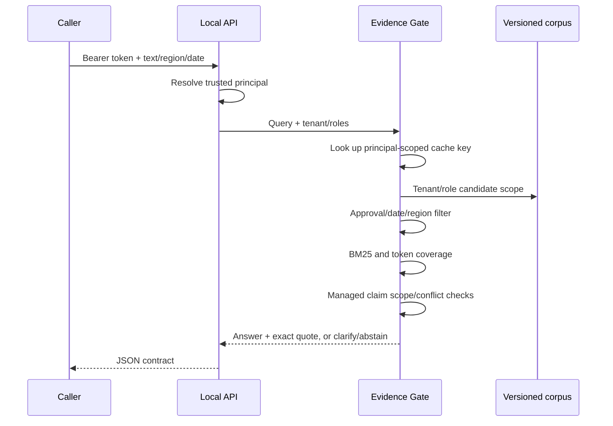

# Architecture and trust boundary

The entry point accepts a query and a **trusted** principal. The principal is a tenant plus roles, established by the surrounding application. The CLI is an in-process demonstration and trusts its operator; its `--tenant` and `--role` flags are not authentication.

The HTTP adapter maps a bearer token to a server-side principal. The request body permits only `text`, `region` and `as_of`. It rejects body-supplied identity fields and does not expose the baseline ablation. Credentials are supplied through an environment variable rather than persisted in this repository. The server binds only to loopback and suppresses default query logging.

## Evidence path

The metadata gates precede ranking. No unauthorized text is sent to a language model; no model is called in this implementation. BM25 is rebuilt on the scoped candidate set for clarity. This is not an efficient design for a large corpus; an indexed implementation must preserve the same authorization semantics.

## Cache contract

The key contains: canonical corpus SHA-256, tenant, sorted roles, region, as-of date, mode, minimum coverage, and normalized query. The cache is bounded to 128 entries by default and uses an `RLock`. Responses and document records are immutable dataclasses; replacing the corpus means constructing a new engine with a different version hash.

This protects the modeled tenant/role boundary. There is no user-level ACL model beyond those roles. User-specific restrictions would have to enter both filtering and cache identity. Authorization changes require a new trusted principal; a bearer-token rotation or identity provider is not implemented.

## Failure behavior

| Condition | Outcome |
|---|---|
| No visible relevant record | `abstain`, no quote |
| Insufficient lexical coverage | `abstain`, no quote |
| Region missing for a multi-region managed claim | `clarify`, no quote |
| Conflicting current approved facts for a managed claim | `abstain`, no quote |
| Approved current scoped fact | `answered` with an exact source span |
| Invalid query/date/region at API | HTTP 400 |
| Missing/invalid token | HTTP 401 |
| Oversized declared API body | HTTP 413 |

The reason for an empty or weak result does not identify invisible records. The broad error contract does not distinguish a nonexistent policy from one unavailable to the requester.

## Deliberate production gaps

No distributed authorization, TLS, credential lifecycle, network rate limits, storage durability, deployment manifests, embeddings, arbitrary semantic conflict model, generative answer model, production throughput benchmark, or customer telemetry is claimed. A real application needs those decisions made and evaluated in its own context. The HTTP server is a local demonstration, not an internet-facing service.
