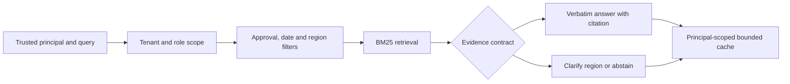
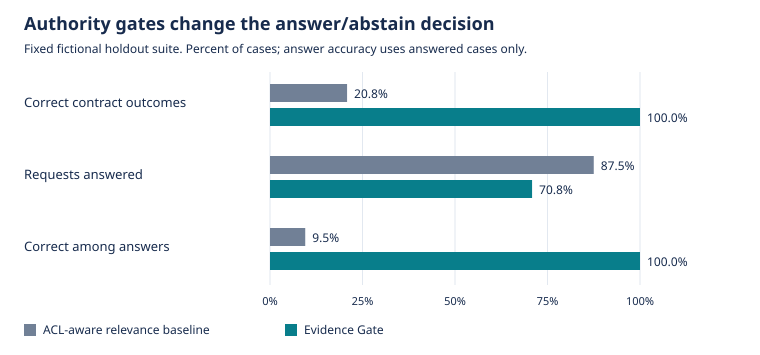

# Evidence Gate: relevance is only one part of a usable answer

**Independent portfolio reference implementation by Vedant Thaker.** This is a newly built public engineering experiment on original fictional data. It does not reproduce a CSAA system, disclose client documents, or verify historical workplace metrics. The evaluated system extracts managed fact spans; no language model was evaluated.

## The decision I started with

Should a support assistant answer because it found a similar document, or only when that document is authorized, approved, current, and specific enough for the request?

I treated the answer as a decision contract. The requester needs a usable policy fact, an exact citation, or an explicit request for clarification. A confident answer from an expired policy is a failure even if the retrieval score is high.

## Topic: document retrieval. Subtopic: admissible evidence

A relevance-only workflow ranks passages and returns the highest match. This experiment implements BM25 from scratch as that comparator. Both systems filter tenant and role permissions **before** scoring. I did not create an artificially unsafe authorization baseline to make the proposed design look better.

The comparator's deliberate limitation is narrower: it ignores approval, validity dates and geographic scope, then answers whenever a positive lexical match exists. It is an ablation, not a claim that all conventional RAG products behave this way.

## I made the failure observable before adding a model

The corpus contains 58 authored policy documents across two fictional tenants. Expired policies and unapproved drafts repeat query terms. Current US and EU refund policies differ. Two simultaneously approved export policies contradict each other. Administrator-only material tests a separate role boundary.

Those are constructed stress cases, not a representative sample of customer traffic. I used eight development cases to exercise the interface and a preassigned 24-case holdout suite for the reported comparison. The threshold and formulas are explicit in `metrics.json`; no threshold search is performed. Because the same author designed the corpus and cases, the split is a reproducibility control, not an independent generalization study.

## My framework: scope, retrieve, validate, answer or abstain

1. Establish the principal outside the query text; scope candidate documents by tenant and roles.
2. Apply approval, half-open validity intervals and an explicit region facet before ranking.
3. Rank the remaining documents with the same BM25 implementation.
4. Require minimum query-token coverage. If a selected managed claim has several regions and none was supplied, request clarification. If authoritative claims disagree, abstain.
5. Return a verbatim span with its source and effective date. Key the bounded cache by tenant, roles, region, date, mode, corpus hash and query.

The claim keys and verbatim fact spans are curated schema fields. This project does not solve arbitrary semantic conflict detection or free-form answer synthesis. Keeping that boundary explicit makes the implementation inspectable.

## The measured result changed the decision, not just the rank

| Holdout measure | ACL-aware relevance baseline | Evidence Gate |
|---|---:|---:|
| Correct answer/clarify/abstain outcomes | 5/24 (20.8%) | 24/24 (100.0%) |
| Requests answered | 21/24 (87.5%) | 17/24 (70.8%) |
| Correct answers among answer attempts | 2/21 (9.5%) | 17/17 (100.0%) |
| Answers using inadmissible evidence | 17 | 0 |

Task success requires exact agreement with both the expected status and fact span. Coverage is answered requests divided by all 24 holdout requests. Selective accuracy uses answered requests as its denominator. An inadmissible answer cites an unapproved, expired, future, or wrong-region document. These metrics are not LLM hallucination or factual-generalization scores.

| Holdout category | Cases | Baseline correct | Gate correct |
|---|---:|---:|---:|
| access boundary | 1 | 0 | 1 |
| ambiguous scope | 2 | 0 | 2 |
| conflicting sources | 1 | 0 | 1 |
| current policy | 15 | 0 | 15 |
| tenant isolation | 3 | 3 | 3 |
| unknown | 2 | 2 | 2 |

Every numerator is reconstructible from `predictions.jsonl`. The benchmark disables the cache for quality evaluation; it cannot win by reusing development answers.

## What the result supports, and what it does not

The observed improvement supports a small engineering decision: in this managed policy fixture, metadata gates and explicit abstention prevent the constructed stale/draft/scope failures. The main tradeoff is reduced answer coverage and additional document-governance work. Requiring a region creates friction when the caller could have supplied one up front.

There is insufficient evidence to estimate production accuracy, latency, financial savings, user satisfaction, or LLM behavior. No paid API, GPU benchmark, customer contract or employer system was used. A perfect result on a small author-written suite is not a deployment approval.

The main alternative is relevance ranking followed by a stronger generative model. I did not run that alternative, so I make no comparative model-quality claim. A stronger model might recognize some policy conflicts, but it still needs trusted identity and version metadata; that is a design inference to test, not a measured result here.

## The next decision I would take to a customer

Keep this as a reference implementation. Before a pilot, obtain permissioned documents and independent queries, test identity integration, review region/validity semantics with policy owners, and evaluate any proposed language model separately. Measure correct supported answers, unnecessary abstention, unauthorized retrieval attempts, document-update lag and end-to-end latency. Revisit the design if document metadata is incomplete or users cannot provide required scope.

My working style is reflected in the artifact: define the decision and denominators first; compare a simple alternative; retain per-case evidence; challenge what the numbers establish; and make the next action proportionate to that evidence.

## Reproduce and inspect

From this project directory: `python -m unittest discover -s tests -v`, then `python -m evidence_gate benchmark`. This report and the chart are generated from the same metrics object as `metrics.json`. Data hashes are recorded there. See the [data card](../data/DATA_CARD.md), [architecture](../docs/architecture.md) and [evaluation protocol](../docs/evaluation.md).

## References and originality

- [Build Your Own X](https://github.com/codecrafters-io/build-your-own-x) supplied the from-scratch learning direction.
- [RAG From Scratch](https://github.com/langchain-ai/rag-from-scratch) supplied conceptual context for indexing, retrieval and grounded generation. No tutorial code, datasets or reported results were copied.
- The BM25 formula is a standard information-retrieval method; the implementation, fictional corpus, query suite, contract layer, API, tests and narrative in this project were written for this repository.
- Robertson and Zaragoza's [The Probabilistic Relevance Framework: BM25 and Beyond](https://doi.org/10.1561/1500000019) is a primary reference for the retrieval method. The nonnegative IDF variant and constants used here are stated in the evaluation protocol.
