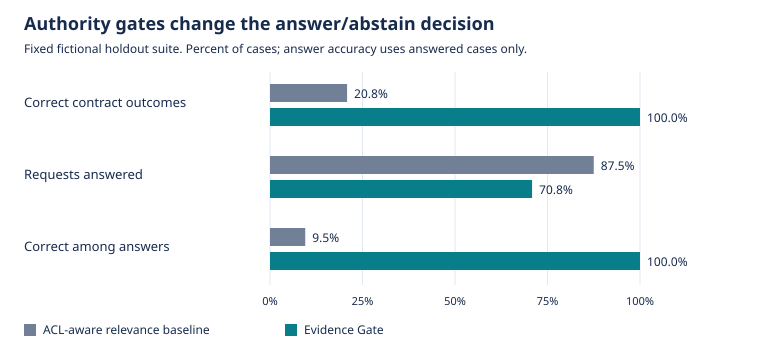

# Which policy passages can support a cited answer?

A support agent looking up a policy can find a passage that matches every keyword and still quote an obsolete rule. Both retrieval paths start from documents visible to the requester's tenant and role. Their difference is what happens to an accessible draft, expired policy, regional exception or conflict after that first filter.

The lexical baseline answered 21 of 24 holdout requests. It cited inadmissible evidence 17 times. The policy gate answered 17 requests and had 0 such citations. In this fixture, the expected behavior on 7 of the 24 cases was to clarify or abstain. Scoring only questions that received answers would discard those decisions.

| Holdout measure | Access-scoped BM25 | Policy gate |
| --- | ---: | ---: |
| Expected outcome and fact span | 5/24 (20.8%) | 24/24 (100.0%) |
| Requests answered | 21/24 (87.5%) | 17/24 (70.8%) |
| Correct among answers given | 2/21 | 17/17 |
| Answers citing inadmissible evidence | 17 | 0 |

## What changes between the two paths

The baseline ranks authorized passages by BM25 and returns a positive lexical match. The gate first checks approval, the half-open validity window and the requested region. After ranking, it requires at least 30% query-token coverage. A missing regional qualifier can trigger a clarification. Contradictory active facts under the same managed claim key trigger abstention.

A returned answer is an exact stored span with a document citation. The [prediction log](predictions.jsonl) keeps the query, principal, expected result, cited document ID, quoted span and decision reason for each run. Filtering those records to one case ID gives the baseline and gated responses side by side. Cache lookup is disabled during quality evaluation.

| Holdout case type | Cases | Baseline correct | Gate correct |
| --- | ---: | ---: | ---: |
| access boundary | 1 | 0 | 1 |
| ambiguous scope | 2 | 0 | 2 |
| conflicting sources | 1 | 0 | 1 |
| current policy | 15 | 0 | 15 |
| tenant isolation | 3 | 3 | 3 |
| unknown | 2 | 2 | 2 |

The 58 fictional documents and 8 development cases exercise the same authored policy schema as the 24 held-out cases. The case mix deliberately emphasizes failure modes. Applying these rates to customer traffic would require independently collected questions, verified policy metadata and a reference answer for each. The source spans here are curated, so this experiment says nothing about a generative model's ability to write an accurate paraphrase.

## Reproduce the contract decisions

Run `python -m unittest discover -s tests -v` and `python -m evidence_gate benchmark` from the project root. Compare the fresh [metrics](metrics.json) with the [data card](../data/DATA_CARD.md), [architecture](../docs/architecture.md) and [evaluation protocol](../docs/evaluation.md).

Independent experiment by Vedant Thaker. The conceptual references are [Build Your Own X](https://github.com/codecrafters-io/build-your-own-x), [RAG From Scratch](https://github.com/langchain-ai/rag-from-scratch), and [Robertson and Zaragoza on BM25](https://doi.org/10.1561/1500000019).
